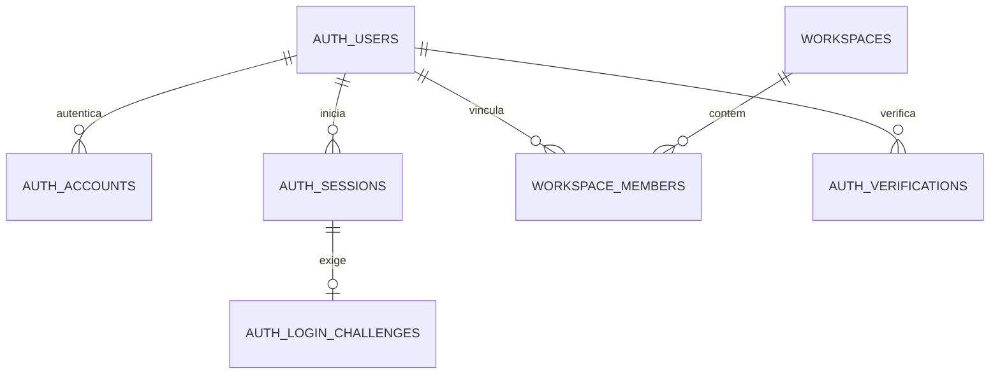
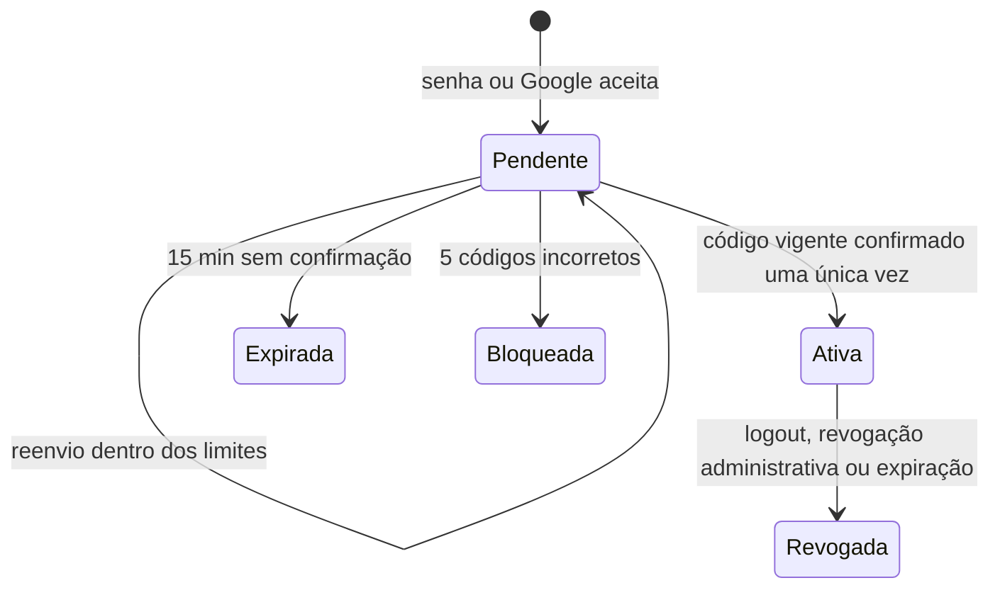
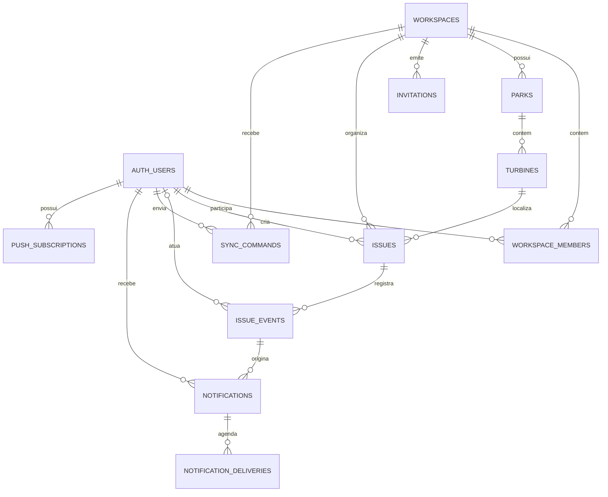

# Modelo de dados — Wind Ops

## Status e escopo

**Fundação implementada localmente em F03.** `0001_auth_core` implementa as tabelas de identidade, desafios e memberships, aplicado ao PostgreSQL local após validação de grants. Domínios operacionais abaixo permanecem planejados.

PostgreSQL é a fonte de verdade online; Drizzle e SQL versionado são a única via de alteração do schema da aplicação. Better Auth possui os dados de autenticação. Cada módulo continua dono das operações e acesso aos próprios dados. FK SQL pode reforçar integridade entre módulos; código de um módulo não importa schema nem repositório privado de outro.

## Regras gerais

- PKs da aplicação e da identidade são UUID v4 gerados pelo servidor/provedor. O schema Better Auth foi configurado e verificado com `advanced.database.generateId: "uuid"`. Entidades que serão criadas offline recebem UUID gerado no cliente, sem depender de sequência do servidor.
- Horários são `timestamptz` em UTC. A API serializa ISO 8601; durações e validade são comparadas pelo relógio do PostgreSQL/servidor, nunca pelo relógio do aparelho para autorizar uma operação.
- E-mails são aparados e normalizados para minúsculas antes da persistência e consulta. Não remover pontos, sufixos `+` ou aplicar regras próprias de Gmail/provedor.
- Segredos opacos só são guardados em texto quando Better Auth exige a busca pelo valor bruto (token de sessão); restringir a coluna e seu papel PostgreSQL. Tokens OAuth são criptografados pelo Better Auth. Identificadores de verification são hasheados; códigos de acesso têm HMAC com segredo de servidor e nunca são armazenados em claro ou como SHA simples de um código curto.
- PK/FK e `UNIQUE`/`CHECK` protegem consistência. Guardas de serviço impõem autorização, papel e transições; não considerar constraints substituto da autorização.
- Exclusão de membro revoga o vínculo, não remove o usuário global nem reescreve eventos. Exclusão de conta e retenção histórica serão serviços explícitos, sem cascata de eventos operacionais.
- Nenhuma tabela de identidade, sessão, senha, token, código, limitação de tentativa ou convite participa de publicação/shape Electric.

## ERD da fundação

`auth_verifications.value` é um valor opaco do provedor; nem toda linha necessariamente referencia um usuário. Rate limits são chaves operacionais, sem FK. As convenções de nomes físicos abaixo são snake_case. As tabelas nativas de Better Auth devem usar `modelName` explícito com prefixo `auth_` e mapeamento de campos; validar nomes/campos gerados por Drizzle contra este contrato antes de produzir a migração.

## Dicionário físico da fundação

### `public.workspaces`

Tabela implementada na migração `0000_workspace_foundation`; preservar nome, dados, UUID e índice singleton existente.

| Coluna       | Tipo          | Nulo/default             | Regra                                       |
| ------------ | ------------- | ------------------------ | ------------------------------------------- |
| `id`         | `uuid`        | não; `gen_random_uuid()` | PK.                                         |
| `name`       | `text`        | não                      | Nome administrativo; aparar espaços na API. |
| `created_at` | `timestamptz` | não; `now()`             | Criação.                                    |

Índices: `workspaces_pkey`; `workspaces_singleton`, único sobre a constante `true`, limita a instalação a um workspace. Remover ou substituir esse limite exige migração revisada, preparação de dados e atualização dos testes. Não assumir que singleton elimina a verificação de tenant.

### `public.auth_users`

Proprietária: `identity`; campos e tipos validados pela geração Better Auth 1.7.12. Uma conta órfã é válida e não tem acesso de negócio até obter membership.

| Coluna           | Tipo          | Nulo/default | Regra                                                |
| ---------------- | ------------- | ------------ | ---------------------------------------------------- |
| `id`             | `uuid`        | não; UUID v4 | PK e ID compartilhado com todas as FKs à identidade. |
| `name`           | `text`        | não          | Nome público do usuário.                             |
| `email`          | `text`        | não          | Único, minúsculo/aparado; propriedade única.         |
| `email_verified` | `boolean`     | não; `false` | Só o fluxo de verificação confiável altera.          |
| `image`          | `text`        | sim          | URL/foto opcional, sem segredo.                      |
| `created_at`     | `timestamptz` | não          | Criação.                                             |
| `updated_at`     | `timestamptz` | não          | Atualização controlada pelo provedor.                |

Constraints/índices: PK em `id`; `UNIQUE(email)`. E-mail normalizado na escrita e lookup; não depender de índice citext ou collation específica do ambiente. Apagar usuário tem de respeitar primeiro memberships e FKs históricas; o procedimento de remoção de conta fica fora desta fundação.

### `public.auth_accounts`

Proprietária: `identity`; cadastro de credencial de senha e vínculos OAuth.

| Coluna                     | Tipo          | Nulo/default | Regra                                                                          |
| -------------------------- | ------------- | ------------ | ------------------------------------------------------------------------------ |
| `id`                       | `uuid`        | não; UUID v4 | PK.                                                                            |
| `account_id`               | `text`        | não          | Identificador atribuído por senha/provedor.                                    |
| `provider_id`              | `text`        | não          | `credential`, `google` ou ID de provedor suportado.                            |
| `user_id`                  | `uuid`        | não          | FK `auth_users.id`; `ON DELETE CASCADE` só para os dados privados desta conta. |
| `password`                 | `text`        | sim          | Hash gerenciado pelo Better Auth; nunca senha recebida.                        |
| `access_token`             | `text`        | sim          | Criptografado em repouso pelo `encryptOAuthTokens` do Better Auth.             |
| `refresh_token`            | `text`        | sim          | Criptografado pelo provedor.                                                   |
| `id_token`                 | `text`        | sim          | Criptografado pelo provedor.                                                   |
| `access_token_expires_at`  | `timestamptz` | sim          | Expiração OAuth.                                                               |
| `refresh_token_expires_at` | `timestamptz` | sim          | Expiração OAuth.                                                               |
| `scope`                    | `text`        | sim          | Scopes concedidos.                                                             |
| `created_at`, `updated_at` | `timestamptz` | não          | Auditoria operacional da conta.                                                |

Constraints/índices: FK e índice em `user_id`; `UNIQUE(provider_id, account_id)` impede vincular a mesma identidade externa a duas contas. Só o provedor de credenciais mantém senha. A política do Better Auth exige titularidade local verificada e email verificado do Google antes de vincular implicitamente contas.

### `public.auth_sessions`

Proprietária: `identity`; contém sessão pendente e sessão liberada. A coluna de segunda etapa é **server-only**; todas as rotas de negócio verificam a presença dela em sessão válida.

| Coluna                     | Tipo          | Nulo/default | Regra                                                                                                          |
| -------------------------- | ------------- | ------------ | -------------------------------------------------------------------------------------------------------------- |
| `id`                       | `uuid`        | não; UUID v4 | PK interna.                                                                                                    |
| `token`                    | `text`        | não          | Token opaco do cookie; `UNIQUE`, sem log/DTO/cópia para storage web. Better Auth precisa dele para lookup.     |
| `user_id`                  | `uuid`        | não          | FK `auth_users.id`; cascade somente para apagar sessão privada ao excluir conta.                               |
| `expires_at`               | `timestamptz` | não          | 15 minutos enquanto pendente; sete dias após confirmação do segundo passo.                                     |
| `email_second_step_at`     | `timestamptz` | sim          | `NULL` bloqueia negócio; após OTP válido, setado na mesma transação de consumo. Não aceito na entrada pública. |
| `ip_address`, `user_agent` | `text`        | sim          | Metadados mínimos; não usar como fator de autorização. Rever minimização/retensão antes de produção.           |
| `created_at`, `updated_at` | `timestamptz` | não          | Controle da sessão.                                                                                            |

Constraints/índices: PK, `UNIQUE(token)` e índice `user_id`. Desativar cache de sessão em cookie e refresh automático até a segunda etapa ser liberada; logout/revogação elimina o bearer no servidor. Não usar o plugin padrão `twoFactor` como barreira do OAuth: na versão auditada, ele desafia apenas sessões de certas rotas de login, não todos os métodos de entrada.

### `public.auth_verifications`

Proprietária: `identity`; tabela interna Better Auth para verificação de e-mail e tokens temporários do provedor. Não é a tabela de desafios do produto.

| Coluna                     | Tipo          | Nulo/default | Regra                                                                                |
| -------------------------- | ------------- | ------------ | ------------------------------------------------------------------------------------ |
| `id`                       | `uuid`        | não; UUID v4 | PK.                                                                                  |
| `identifier`               | `text`        | não          | Identificador de busca hasheado por `storeIdentifier: "hashed"`; índice para lookup. |
| `value`                    | `text`        | não          | Valor opaco exigido pelo fluxo interno; não retornado ao cliente.                    |
| `expires_at`               | `timestamptz` | não          | Validade do provedor.                                                                |
| `created_at`, `updated_at` | `timestamptz` | não          | Metadados do registro.                                                               |

Índice: `identifier`. Nunca registrar os dois campos em log; excluir expirados por rotina limitada e segura quando necessário. A retenção exata depende dos fluxos nativos confirmados em F04.

### `public.auth_rate_limits`

Proprietária: `identity`; armazenamento PostgreSQL do limitador nativo. Não substituir pelos limites do código OTP sem comprovar compatibilidade com os caminhos do provedor.

| Coluna         | Tipo      | Nulo/default | Regra                                                              |
| -------------- | --------- | ------------ | ------------------------------------------------------------------ |
| `id`           | `uuid`    | não; UUID v4 | PK do adaptador.                                                   |
| `key`          | `text`    | não          | Buckets internos; único. Restringir acesso, expiração e exposição. |
| `count`        | `integer` | não          | Contagem controlada pelo provedor.                                 |
| `last_request` | `bigint`  | não          | Epoch em milissegundos conforme contrato Better Auth.              |

Constraint: `UNIQUE(key)`. Limpeza de buckets expirados e limites por endpoint/IP/conta serão definidos e testados em F04; não depender apenas de limites por IP.

### `public.auth_login_challenges`

Proprietária: `identity`; desafio do segundo passo obrigatório do produto, independente do mecanismo de verificação de propriedade de e-mail do provedor.

| Coluna                     | Tipo          | Nulo/default | Regra                                                                                                                                                   |
| -------------------------- | ------------- | ------------ | ------------------------------------------------------------------------------------------------------------------------------------------------------- |
| `id`                       | `uuid`        | não; UUID v4 | PK.                                                                                                                                                     |
| `session_id`               | `uuid`        | não          | FK única para `auth_sessions.id`, `ON DELETE CASCADE`; um desafio por sessão provisória, atualizado no reenvio.                                         |
| `code_mac`                 | `bytea`       | não          | HMAC do código, do desafio e da sessão com chave de servidor derivada da chave de autenticação. Comparação em tempo constante; nunca plain/SHA simples. |
| `expires_at`               | `timestamptz` | não          | Válido por 15 minutos segundo o relógio servidor.                                                                                                       |
| `attempts`                 | `smallint`    | não; `0`     | Falhas; máximo de 5, incrementado atomicamente. Ao exceder, desafio inválido e sessão revogada.                                                         |
| `sent_at`                  | `timestamptz` | não          | Último envio confirmado pelo adaptador de e-mail.                                                                                                       |
| `send_count`               | `smallint`    | não; `1`     | Envios da janela, limitada a 3 por 15 minutos por conta; novo envio após 60 segundos. Contador reinicia fora da janela.                                 |
| `window_started_at`        | `timestamptz` | não          | Início da janela de reenvios.                                                                                                                           |
| `consumed_at`              | `timestamptz` | sim          | Consumo único; não reativar após confirmação/falha terminal. Reenvio pode substituir MAC/validade somente enquanto não consumido e dentro dos limites.  |
| `created_at`, `updated_at` | `timestamptz` | não          | Controle do desafio.                                                                                                                                    |

Constraints/índices: PK; `UNIQUE(session_id)`; FK cascade da sessão; `CHECK(attempts BETWEEN 0 AND 5)` e `CHECK(send_count BETWEEN 1 AND 3)`; índice `expires_at` para limpeza. A transação de confirmação bloqueia a linha do desafio e a sessão (`FOR UPDATE` ou equivalente), confere validade/contagem, consome o desafio e preenche `email_second_step_at` na sessão atomicamente. Duas confirmações concorrentes só podem produzir um sucesso.

Após emissão, entrega de e-mail que falha não concede acesso; permitir solicitação recuperável respeitando cooldown/limites e invalidar o código anterior ao reenvio. Atualizar `expires_at` da sessão pendente para acompanhar novo prazo. Desafio expirado, excedido ou consumido não pode liberar sessão. F04 implementa e testa essa operação; o esquema, sozinho, não oferece atomicidade.

### `public.workspace_members`

Proprietária: `workspaces`; um registro por pessoa/workspace, mantendo o registro ao revogar para que histórico de ator continue referenciável.

| Coluna         | Tipo          | Nulo/default | Regra                                                                                                                                            |
| -------------- | ------------- | ------------ | ------------------------------------------------------------------------------------------------------------------------------------------------ |
| `id`           | `uuid`        | não; UUID v4 | PK estável do vínculo.                                                                                                                           |
| `workspace_id` | `uuid`        | não          | FK `workspaces.id`; `ON DELETE RESTRICT`.                                                                                                        |
| `user_id`      | `uuid`        | não          | FK `auth_users.id`; `ON DELETE RESTRICT`.                                                                                                        |
| `role`         | `text`        | não          | `CHECK(role IN ('admin','technician'))`; papel por workspace.                                                                                    |
| `revision`     | `integer`     | não; `1`     | Incrementa em promoção, revogação e reativação por convite. Comandos de administração exigem a revisão observada para impedir retries obsoletos. |
| `created_at`   | `timestamptz` | não; `now()` | Criação do vínculo.                                                                                                                              |
| `revoked_at`   | `timestamptz` | sim          | Nulo = membership ativa; preenchido = revogada. Não remover a linha em desligamento comum.                                                       |

Constraints/índices: `UNIQUE(workspace_id,user_id)`, `UNIQUE(id,workspace_id,user_id)` para referências compostas futuras, FK para os dois pais, índice `(user_id, revoked_at)` e `(workspace_id, revoked_at)`. Alteração de cargo, revogação e bootstrap passam por transação de serviço. E05 preserva todos os admins e impede auto-revogação; não permitir cadastro público de workspace. A revisão aumenta nas transições de cargo, revogação e reativação, e a API exige a revisão observada no comando.

### `public.workspace_invitations`

Proprietária: `workspaces`; histórico de convites enviados a um workspace. Token aleatório de 32 bytes codificado em base64url é apresentado uma vez no link; somente SHA-256 binário (32 bytes) fica no banco. Não retorna no DTO nem aparece em logs. `email` é aparado/minúsculo sem regras específicas de provedor; cargo permitido `admin|technician` e padrão `technician`; prazo emitido de 48 horas.

| Coluna                               | Tipo            | Nulo/default                           | Regra                                                                                           |
| ------------------------------------ | --------------- | -------------------------------------- | ----------------------------------------------------------------------------------------------- |
| `id`                                 | `uuid`          | não; aleatório                         | PK.                                                                                             |
| `workspace_id`                       | `uuid`          | não                                    | FK `workspaces.id`, restrict. Toda consulta/alteração exige escopo autorizado no servidor.      |
| `email`                              | `text`          | não                                    | Normalizado; check `lower(btrim(email)) = email`, comprimento 3–320.                            |
| `role`                               | `text`          | não; `technician`                      | Check `admin                                                                                    | technician`; papel passa à membership no aceite. |
| `invited_by_user_id`                 | `uuid`          | não                                    | FK composta para membership do mesmo workspace; identifica o autor mesmo após revogação.        |
| `token_hash`                         | `bytea`         | não                                    | SHA-256 do token; check de 32 bytes e unique. Token bruto nunca persistido.                     |
| `created_at`, `expires_at`           | `timestamptz`   | criação `now()`; expiração obrigatória | Check expiração posterior à criação; emissão define +48h. Aceite compara com relógio do banco.  |
| `accepted_at`, `accepted_by_user_id` | timestamp, UUID | sim                                    | Ambos nulos ou ambos preenchidos; FK de usuário para `auth_users`. Consumo único.               |
| `revoked_at`                         | `timestamptz`   | sim                                    | Revogação explícita ou encerramento por falha de entrega.                                       |
| `superseded_by_invitation_id`        | `uuid`          | sim                                    | FK composta `(id,workspace_id)` para impedir substituição entre tenants.                        |
| `delivery_status`                    | `text`          | não; `pending`                         | `pending                                                                                        | sent                                             | failed`, coerente com `sent_at`/`delivery_failed_at`; falha encerra convite via `revoked_at`. |
| `sent_at`, `delivery_failed_at`      | `timestamptz`   | sim                                    | Evidência de resultado do adaptador de e-mail; não significa que o destinatário leu a mensagem. |

Há no máximo um convite não terminal por `(workspace_id,email)`, garantido por índice único parcial enquanto não aceito, revogado ou substituído. Expiração é avaliada na operação e não entra no índice: ao reenviar, a transação substitui o registro vigente (mesmo se expirado) e grava novo convite; estados anteriores permanecem consultáveis. O índice adicional `(workspace_id,created_at DESC,id DESC)` atende paginação estável. O schema Drizzle de `workspaces` descreve índices/checks/FKs locais; a FK de `accepted_by_user_id` é SQL explícito porque `identity` é outro módulo e não pode ser importado como schema.

Envio SMTP/Resend ocorre depois do commit, sem segurar transação durante rede. Sucesso marca `sent`; falha marca `failed` e `revoked_at`. Se o processo cair após o commit e antes de atualizar o estado, `pending` permanece diagnosticável e um novo envio cria token/registro e substitui o anterior; nenhum token precisa ser recuperado do banco. Não há outbox nem retry automático nesta etapa. Aceite bloqueia a linha do convite, exige token constante-time comparado por hash, não expirado, não encerrado, sessão com segunda etapa concluída e e-mail verificado igual ao normalizado; atualiza membership e consumo atomicamente. Revogação de membership invalida convites não terminais dentro da mesma transação. Todas as decisões de tenant continuam em `workspaces`.

E04 serializa emissão, reenvio e aceite pela linha do workspace (`FOR UPDATE`), depois bloqueia convite e membership; a revogação da E05 deve seguir essa ordem. Aceite de membership ativa retorna conflito sem trocar cargo. Membership revogada só pode ser reativada por convite criado depois da revogação; convite antigo não restaura acesso. Limites: até 10 envios por admin/hora, 5 emissões/reenvios por workspace/e-mail/24h e 30 tentativas de aceite por IP/minuto. Principal e IP entram na tabela de rate limit somente como HMAC. Link usa `#token=...` para que segredo não seja enviado em requisição HTTP/referrer; nenhum GET consome convite, e a API só aceita token no POST autenticado.

## Segundo fator e estados de sessão

O segundo fator do projeto é **uma confirmação por código de e-mail para toda nova sessão online**, inclusive OAuth. Não é o recurso opt-in de TOTP/trusted-device do plugin Better Auth `twoFactor`.

**Senha:** cadastrar com verificação de e-mail antes de liberar login; autenticação correta cria apenas sessão pendente. **Google:** validar assinatura/issuer/audience/nonce pelo Better Auth; recusar e-mail não verificado antes de criação/vínculo; conta existente só recebe vínculo implícito após o e-mail local também estar verificado. Após qualquer primeira etapa, emitir desafio e manter sessão sem acesso de negócio. O marcador só é preenchido após confirmar OTP.

Rotas públicas enumeradas de auth são as exceções ao bloqueio de sessão pendente: confirmação, reenvio, verificação de e-mail e recuperação de senha, mais operações sem sessão explicitamente documentadas. Atualização de perfil, conexão/desconexão de provider, gerenciamento de sessão, mudança de e-mail/senha com sessão, dados do usuário e toda rota operacional são bloqueadas até confirmação. Não retornar sessão pendente como `authenticated` em `/api/me`. A matriz e teste de todas as rotas precisam constar em F04 antes de montar Better Auth no servidor.

Política inicial para F04: código decimal de 8 dígitos, 5 falhas, até 3 envios por 15 minutos, intervalo mínimo de 60 segundos, expiração de 15 minutos; lockout revoga a sessão provisória. Mensagens públicas não confirmam existência de conta. F04 implementou e integrou esses limites no fluxo de senha; OAuth ainda aguarda testes de callback/vinculação e as rotas permanecem desabilitadas. Mudanças nesse limite exigem atualizar este modelo e os testes.

**Recuperação da senha** usa o token de uso único/expiração nativos e separados dos desafios. A redefinição revoga sessões existentes e a próxima entrada ainda exige o segundo fator. Verificação de e-mail prova titularidade e não equivale ao segundo fator de uma sessão.

## Mapa de evolução por etapa do roadmap

Os nomes abaixo são entidades planejadas; não são tabelas existentes nem migrações para esta fundação. Campos detalhados serão adicionados antes da respectiva implementação.

| Etapa do roadmap   | Entidades                                                                                                         | Invariantes que o esquema precisa suportar                                                                                                                                                                                                                                                                     |
| ------------------ | ----------------------------------------------------------------------------------------------------------------- | -------------------------------------------------------------------------------------------------------------------------------------------------------------------------------------------------------------------------------------------------------------------------------------------------------------- |
| 03 — Identidade    | `auth_users`, `auth_accounts`, `auth_sessions`, `auth_verifications`, `auth_rate_limits`, `auth_login_challenges` | UUID coerente entre o provedor e as FKs; account/provider único; sessão pending sem privilégio; códigos/recovery expirados e de uso único. Fundação F01–F04.                                                                                                                                                   |
| 04 — Workspaces    | `workspace_members`, `workspace_invitations`                                                                      | Convite associado a workspace, e-mail normalizado, cargo, expiração, uso único e invalidação de convite anterior; role fica no vínculo. A membership da fundação antecede o resto desta etapa.                                                                                                                 |
| 05 — Parks         | `parks`, `turbines`                                                                                               | Ambas possuem `workspace_id`; código de parque único por workspace; código de turbina único por parque; FK composta `(park_id,workspace_id)` impede associação entre tenants. Exclusão/arquivamento dependerá de consulta e locks compatíveis com issues.                                                      |
| 06 — Issues        | `issues`, `issue_events`, `issue_location_references`                                                             | UUID no cliente; tenant e localização com FKs compostas; criador/atendente vinculados à membership histórica; texto, estado e revisão; referência relacional preserva toda localização citada em evento e impede exclusão física posterior.                                                                    |
| 07 — Offline/sync  | `sync_commands`                                                                                                   | Recibos de sucesso com chave única por tenant/ator/comando, hash SHA-256 do payload e resultado JSON. Erros não geram recibo; registros não expiram nem são atualizados/excluídos pelo runtime. A outbox local fica no dispositivo e é uma camada distinta.                                                    |
| 08 — Lifecycle     | `issue_events`                                                                                                    | Eventos append-only com tipo, instante do servidor, ator nullable + rótulo de autor preservado, antes/depois estruturado e referência à issue/tenant. Restore gera novo evento; nunca apagar histórico em cascata.                                                                                             |
| 09 — Notifications | `notifications`, `push_subscriptions`, `notification_deliveries`                                                  | Evento/notificação deduplicados por chave única; subscription pertence ao usuário/tenant conforme desenho de acesso; entrega outbox com tentativas, lease/claim e próximo retry; excluir endpoint expirado sem apagar histórico. Criar as tabelas outbox a tempo da transação issue/evento que agenda entrega. |
| 10 — Queries       | Sem nova tabela presumida                                                                                         | Índices validados por consulta/EXPLAIN; filtros e paginação sempre incluem workspace. Não criar duplicação/cache permanente sem evidência de perfil.                                                                                                                                                           |
| 11 — Produção      | Sem nova entidade de produto                                                                                      | Roles, TLS, publicação Electric explícita, backups/restauração, migração compatível e retenção WAL são configuração/operabilidade, não tabelas inventadas.                                                                                                                                                     |

### Modelo Issues — I01 (contrato concluído em 26/10/2026)

O recorte online inicial usa `issues` e `issue_events`; recibos de comandos ficam em `sync_commands`. A transação de uma mutação autoriza membership ativa, valida revisão, grava a mudança, insere evento append-only e persiste o recibo de sucesso atomicamente. Eventos têm UUID estável, `workspace_id`, issue, membership histórica nullable, rótulo do ator preservado, tipo, instante do servidor e snapshots antes/depois. Membership revogada continua identificável como autora de histórico. Uma relação durável `issue_location_references` registra cada equipamento citado na localização inicial/edição e aponta para issue/evento, parque/turbina e workspace por FKs compostas; essa relação histórica impede exclusão física mesmo depois da issue mudar de localização.

S03 — projeção autorizada Electric: `issue_events` contém `actor_membership_id`, `actor_user_id` e snapshots `before`/`after` com campos internos de handler. Por isso não é publicada. `audit` mantém, na mesma transação, `issue_sync_events`, uma projeção append-only contendo só ID de evento/issue/workspace, `actor_label`, tipo, instante e snapshots sanitizados com texto, localização, status, relato e revisão. A tabela privada `issues` tem a projeção `issue_sync_rows`, atualizada por trigger na mesma transação e sem IDs de membership/usuário. Electric 1.8.1 exige `REPLICA IDENTITY FULL` e publica todas as colunas das tabelas aprovadas; assim `workspaces`, `parks`, `turbines` e as projeções sanitizadas são a allowlist. Workspace expõe somente ID, nome e criação. A API Fastify fixa tabela, colunas e `workspace_id = $1`; clientes só enviam parâmetros do protocolo Electric validados. A publication e os grants da role `windops_replication` são reconciliados explicitamente em `infra/postgres/provision-roles.sh`.

O contrato compartilhado define estados `pending`, `in_progress` e `completed`; eventos `created`, `edited`, `started`, `returned`, `released` e `completed`; texto aparado não vazio até 10.000 caracteres; relato de conclusão opcional até 10.000 caracteres; revisão positiva; criador e responsável como identidade/membership; DTOs estritos e cursores UUID com limite 1–100 (padrão 25). A consulta ativa implementada ainda ordena por `created_at ASC, id ASC`; por solicitação do proprietário, a Home deverá passar a exibir as issues mais recentes primeiro, com paginação global ajustada na S07. Histórico concluído já ordena por `updated_at DESC, id DESC` para exibir as conclusões mais recentes primeiro. Filtro `active` abrange somente pendentes/em andamento. Criação recebe UUID de issue e `commandId` UUID do cliente; atualizações exigem `expectedRevision`. I04 implementa POST/PATCH e calcula SHA-256 sobre objeto canônico da operação/payload; a chave é isolada por workspace/ator/comando. Mesmo comando/hash retorna a resposta gravada depois de revalidar sessão e membership; mesmo comando com hash diferente conflita. Erros antes do commit não deixam recibo de sucesso. Retenção não expira neste recorte.

Permissões: admin e technician ativos criam e consultam; membros ativos iniciam para si, mas o criador só pode iniciar após uma hora desde `created_at`, calculada com relógio do banco. Somente criador edita texto/localização enquanto a issue estiver pendente; somente responsável ativo devolve ou conclui; admin ativo pode liberar responsável alheio, inclusive após revogação dele. Nenhuma rota permite atribuição a terceiros. Conclusão define `completed`, preserva responsável e salva relato opcional, evento e recibo idempotente atomicamente.

Serviços públicos pelos entrypoints `issues`, `audit`, `sync` e `parks`; os serviços de audit/sync e locks de parks recebem o executor transacional, sem importar schema ou repositório de outro módulo. `issues` expõe verificação de referências/histórico; `audit` faz append de evento e referência de localização; `sync` faz lookup/gravação de recibo; `parks` bloqueia parques e turbinas em ordem UUID e verifica atividade efetiva. Workspaces revalida sessão e bloqueia workspace→membership antes dos recursos; a identidade fornece campos públicos mínimos. Ordem estável: workspace, membership, parques em UUID ascendente, turbinas em UUID ascendente e issue. POST/PATCH de issues mantém locks de localização até o commit e depois bloqueia a issue. Lifecycle administrativo deve usar os mesmos locks antes de verificar issues abertas e referências históricas; manter locks até commit. Issue aberta deve impedir arquivo; referência histórica deve impedir exclusão física.

Decisões do proprietário em 26/10/2026: arquivar parque/turbina é proibido enquanto houver issue aberta atualmente localizada no recurso; para parque, a regra inclui todas as turbinas descendentes. A verificação e a operação usam os mesmos locks da criação/edição para impedir corrida. Issues existentes nunca são alteradas pelo arquivo. Se não houver issue aberta atualmente associada mas houver qualquer referência atual/histórica, arquivar preservando o agregado e os eventos; sem referências, excluir fisicamente. Referências históricas permanecem após edição de localização e impedem exclusão física, mas não impedem arquivo se a issue foi movida e já não está atualmente localizada ali. Os estados disponíveis nesta slice (`pending`, `in_progress`) são ambos abertos; por isso uma referência pode ser arquivada quando não for mais a localização atual, mesmo que a issue continue aberta em outro equipamento. A etapa 08 deve ampliar o predicado de issue aberta quando implementar conclusão/reabertura, sem mudar esta regra.

Parque arquivado torna suas turbinas efetivamente indisponíveis sem alterar `turbines.deactivated_at`. Ao restaurar parque, turbinas que já estavam individualmente arquivadas continuam arquivadas; somente as não arquivadas voltam a ficar ativas efetivamente. Equipamento arquivado não recebe issue nova. Issues abertas impedem que um recurso seja arquivado, então não existe atendimento aberto em equipamento arquivado; histórico encerrado permanece consultável e imutável.

Rotas implementadas em `/api/workspaces/:workspaceId/issues`: GET lista/detalhe/eventos; POST cria (`issueId`, `commandId`, parque, turbina e texto); PATCH edita texto/localização com `commandId` e `expectedRevision`; POST `/:issueId/start`, `/return`, `/release` e `/complete` recebem chave e revisão esperada. Conclusão aceita relato opcional. Toda mutação revalida sessão/membership dentro da transação. O autor só edita a própria issue pendente e só pode iniciar após uma hora; outros membros podem iniciar imediatamente. Somente responsável ativo devolve/conclui; somente admin ativo libera atendimento alheio, mesmo com responsável revogado. Primeira transição válida vence sob o lock de workspace; as demais recebem conflito de revisão/estado. Cada transição incrementa revisão e grava snapshot/evento/recibo no mesmo commit. Replay válido devolve a resposta original sem reaplicar estado. Criação valida localização ativa e edição pode manter localização arquivada, mas destino alterado precisa estar ativo. UUID já usado conflita sem expor issue de outro tenant; recurso externo é indistinguível. Nenhum endpoint aceita ator, tenant, responsável escolhido ou atribuição a terceiros no body.

### Modelo Parks — contrato P01

`parks` e `turbines` são entidades tenant-owned, com `id uuid` estável, `workspace_id uuid NOT NULL`, `code varchar(7) NOT NULL`, `created_at`/`updated_at timestamptz NOT NULL`, `revision integer NOT NULL DEFAULT 1 CHECK (revision > 0)` e `deactivated_at timestamptz NULL`. Turbinas têm também `park_id uuid NOT NULL`. Não há entidade `elevators`: cada turbina representa um elevador no piloto. Quantidade não é limitada pelo modelo.

Normalização de códigos ocorre na entrada da API: remover espaços nas pontas e converter ASCII para maiúsculas. Formato aceito pelo contrato: `P` ou `T` seguido de 2 a 6 algarismos ASCII (`P01`, `P123456`, `T01`); a interface gera sequências com pelo menos três algarismos (`P001`, `T001`). Zeros à esquerda são significativos. Não reutilizar código arquivado: unicidade inclui registros com `deactivated_at`. Duplicidade resulta em conflito. Renomear mantém UUID e relações; mover turbina para outro parque fica fora do catálogo inicial.

`deactivated_at` começa nulo. Implementado na I06: admin exclui definitivamente parque/turbina sem referências atuais ou históricas; com histórico e sem issue aberta atualmente associada, arquiva preservando issues/eventos e permite restauração; enquanto houver issue aberta atualmente associada, não pode arquivar (nem turbina nem parque com alguma filha nessa condição). A checagem é transacional e serializada com criação/edição de localização e cadastro/restauração de turbina. Arquivar parque torna todas as turbinas efetivamente indisponíveis sem alterar seu estado individual; restaurar parque mantém arquivadas as turbinas que já estavam individualmente desativadas. Equipamento inativo não recebe issue nova. Issues e eventos existentes não são alterados pelo arquivo. Recibos em `sync_commands` guardam ator e resultado idempotente do lifecycle; não foi necessária migration.

Contratos compartilhados Zod são estritos. DTOs de parque expõem apenas `id`, `workspaceId`, `code`, timestamps, `revision` e `deactivatedAt`; turbina adiciona `parkId`. Create aceita somente `code`; update aceita `code` e `expectedRevision` positivo. O cliente não escolhe tenant nem associação da turbina no corpo; workspace e park vêm da rota após autorização. Toda edição incrementa revisão no servidor e conflito de revisão retorna erro recuperável sem sobrescrever. Não permitir alteração de `parkId`.

Listas aceitam `limit` inteiro 1–100 (padrão 25), `cursor` UUID opcional e `search` aparado de 1–100 caracteres. Busca é prefixo literal do código, sem diferenciar caixa. Ordenação canônica por `code ASC, id ASC`; cursor referencia o último item e a consulta resolve seu par `(code,id)` dentro do tenant autorizado. UUID inexistente ou fora do escopo retorna o mesmo erro `INVALID_CURSOR` (400), sem revelar se o registro existe em outro tenant. Resposta `{items, nextCursor}` com cursor UUID ou null.

Endpoints sob `/api/workspaces/:workspaceId`: GET de parks/turbines implementados em P03; `POST /parks`, `PATCH /parks/:parkId`, `POST /parks/:parkId/turbines` e `PATCH /parks/:parkId/turbines/:turbineId` implementados em P04; I06 adiciona `DELETE /parks/:parkId`, `POST /parks/:parkId/restore`, `DELETE /parks/:parkId/turbines/:turbineId` e `POST /parks/:parkId/turbines/:turbineId/restore`. Ambos os cargos com sessão completa e membership ativa podem consultar; somente admin grava lifecycle. Escrita revalida identity e membership dentro da transação, bloqueia primeiro workspace e depois membership, e confirma a mudança antes do commit. Código duplicado retorna `409 CATALOG_CODE_TAKEN`; revisão obsoleta retorna `409 REVISION_CONFLICT`. Replays são autorizados antes de consultar recibo; sessão/membership revogada não pode reproduzir resultado. O guard valida tenant em toda requisição; UUID recebido do cliente não comprova autorização.

Serviço público de parks expõe validação/leitura da localização usando um `PoolClient` já dentro da transação, para issues não importar schema/repositório interno. O lifecycle protege concorrência entre criação/edição/atendimento de issue e exclusão/arquivamento: usar protocolo comum parque→turbina; operação de issue bloqueia localização sob `FOR SHARE`; operação admin bloqueia os mesmos registros e consulta pelo serviço público de issues as issues abertas e referências históricas antes de excluir (sem referências), arquivar (histórico sem issues abertas) ou responder conflito (issue aberta). `FOR SHARE` conflita com lock de escrita; locks ficam até commit. Para parque, bloquear turbinas em ordem UUID estável. `issue_location_references` preserva por FK composta as localizações atuais e anteriores citadas em eventos, mesmo após edição; não apagar evento nem referência por cascata. Validar corridas, preservação de eventos, restauração e FKs em integração antes de expor lifecycle.

Em tabelas tenant-owned, FK direta a `workspace_id` e, quando houver pai tenant-owned, FK composta `(parent_id,workspace_id)` tornam o tenant parte da integridade relacional. Atores com histórico referenciam o par `(workspace_id,user_id)` de uma membership que permanece revogada, enquanto os guards exigem `revoked_at IS NULL` para ações novas. Um membro removido pode seguir como autor de eventos antigos.

## Papéis PostgreSQL e acesso

| Papel                  | Privilégios                                                                                                                                                              | Limite                                                                                                                                                |
| ---------------------- | ------------------------------------------------------------------------------------------------------------------------------------------------------------------------ | ----------------------------------------------------------------------------------------------------------------------------------------------------- |
| Owner de bootstrap/DBA | Criar roles/schema/publication, ownership de tabelas, grants e recuperação administrativa. Credencial fora da API.                                                       | Nunca fornecido ao app/Electric.                                                                                                                      |
| `windops_migrator`     | Login e DDL de migrações sob job explícito; owner das tabelas da aplicação necessário para alterar schema.                                                               | Não é usado em requests. Credencial direta; não armazenada no frontend.                                                                               |
| `windops_app`          | Conectar e executar somente DML nas tabelas usadas pela API, inclusive auth necessária. Sem superuser, `CREATEROLE`, `CREATEDB`, `REPLICATION`, ownership geral nem DDL. | Contexto tenant sempre validado pelo serviço; conceder o mínimo por schema/tabela.                                                                    |
| `windops_replication`  | Conectar, `REPLICATION` e `SELECT` apenas nas tabelas efetivamente publicadas.                                                                                           | Usar publicação manual; sem acesso a `auth_*`, desafios, memberships privadas ou outbox. Electric/API não recebe URL ampla nem acesso público direto. |

Electric expõe conteúdo acessível pela credencial da conexão e sua API é pública por padrão. Usar proxy Fastify autenticado para shapes, com tabela, colunas e filtro do workspace fixados pelo servidor. As tabelas de identidade e as tabelas brutas com IDs privados não entram na publicação. Electric 1.8.1 exige `REPLICA IDENTITY FULL`; como isso publica todas as colunas no PostgreSQL 17, tabelas com campos privados usam projeções sanitizadas antes da publicação. A API também seleciona explicitamente as colunas da resposta.

Não configurar RLS como substituto dos guards. Se vier a ser acrescentado, provar comportamento com o papel real de replicação e policy, porque replicação logical pode ignorar row security sob configurações/roles aplicáveis. A etapa 07 deve detalhar esses testes.

## Transações, retenção e exclusão

- Confirmação do OTP: bloqueia desafio e sessão, verifica estado/limites e atualiza consumo + sessão em uma transação.
- Operação de issue futura: autoriza membership/cargo; valida revisão/versão; aplica a mudança, grava evento e chave de comando idempotente. Entrega de push fica na outbox PostgreSQL na mesma transação. Enviar rede/email/push fora da transação e marcar retry/ack de forma idempotente.
- Revogar membership: alterar `revoked_at` em transação e impedir comandos subsequentes no servidor. Não apagar usuário, issue ou evento. Reconvite/reactivação atualiza o vínculo existente ou segue política de reintegração aprovada na etapa 04; nunca criar duplicata que viole a chave única.
- Expurgo de sessão, verification e challenge vencidos é limitado por lotes/índice e pode ser repetido. Preservar eventos conforme política operacional ainda a definir; nenhuma limpeza global durante startup.
- Excluir identidade no futuro exige revogação de membership, resolução da regra de último administrador e anonimização das referências de ator; eventos continuam com rótulo “Usuário excluído”. Não apagar histórico por FK cascade.
- Migrações destrutivas seguem expansão/contração, backup e aprovação. Não há rollback automático de schema no deploy; migração e imagem anterior devem coexistir durante rollout.

## Plano de migrações da fundação

| Ordem       | Migração                                                             | Conteúdo                                                                                                                                                                                                                                                                                                                                                    |
| ----------- | -------------------------------------------------------------------- | ----------------------------------------------------------------------------------------------------------------------------------------------------------------------------------------------------------------------------------------------------------------------------------------------------------------------------------------------------------- |
| Já aplicada | `0000_workspace_foundation`                                          | `workspaces` e índice singleton; preservar checksum e dados.                                                                                                                                                                                                                                                                                                |
| F03         | `0001_auth_core`                                                     | Cinco tabelas Better Auth, `auth_login_challenges` e `workspace_members`, criadas juntas em migração atômica. Inclui UUID, snake_case, índices, checks e FKs; a FK cruzada de membership é SQL revisado. Nenhuma rota de auth habilitada.                                                                                                                   |
| F02         | grants/config de ambiente                                            | Provisionamento versionado/repetível separado do DDL de negócio, que suporta banco novo e volume existente; migrador serializado com credencial própria. Não executar init scripts destrutivos em volumes ativos.                                                                                                                                           |
| E02         | `0002_workspace_invitations`                                         | `workspace_invitations`, com hash de token, estados de entrega/consumo, checks, índices e FKs para workspace, autor, substituição e usuário que aceitou. API recebe DML via default privileges; sem grant/publicação para Electric.                                                                                                                         |
| E04         | sem DDL adicional                                                    | Emissão, reenvio e aceite; usa `auth_rate_limits`.`0002_workspace_invitations` aplicada ao dev persistente após integração em banco descartável. Sem outbox.                                                                                                                                                                                                |
| E05         | `0003_workspace_member_revision`                                     | Revisão otimista de membership para promoção/revogação e proteção contra retry após reintegração; integração descartável e aplicação dev concluídas.                                                                                                                                                                                                        |
| P02         | `0004_parks_turbines`                                                | Tabelas `parks`/`turbines`, validações de código/revision, unicidades e FKs tenant; grants DML para API via default privileges. Sem grant/publicação para Electric. Aplicada ao dev e validada em banco vazio, concorrência e upgrade.                                                                                                                      |
| I02         | `0005_issues_audit_sync`, `0006_issue_integrity_checks`              | Issues, eventos, referências relacionais a cada localização histórica e recibos de comando com FKs tenant, checks e índices. `windops_app` recebe DML em issues e somente SELECT/INSERT em eventos, referências e recibos; sem acesso de replicação/Publicação Electric. Aplicadas no dev após upgrade 0004 e restore descartáveis aprovados em 26/10/2026. |
| S03         | `0008_sync_shapes`, `0009_sync_event_checks`, `0010_sync_issue_rows` | Projeção append-only `issue_sync_events` e espelho atualizado por trigger `issue_sync_rows`, sem identidade interna. Publication manual inclui somente workspaces, parks, turbines e as duas projeções; Electric exige `REPLICA IDENTITY FULL` e replica todas as colunas dessas tabelas sanitizadas.                                                       |

Gerar e revisar SQL com Better Auth 1.7.12 + Drizzle e `schema: "public"`/mapeamento explicitamente alinhado. A ferramenta Better Auth `generate` pode gerar definição ORM, mas Drizzle controla journal e aplicação. Não rodar migration CLI do Better Auth contra ambiente compartilhado. Validar banco vazio e atualização de `0000` com os mesmos contratos, dupla execução, FKs/índices e imagem de runtime.

Bootstrap do primeiro administrador é procedimento administrativo transacional separado depois de uma conta criada e verificada: recebe IDs confirmados de usuário/workspace; cria workspace se ainda vazio, insere membership `admin`; repetição idêntica não muda outros registros; conflito/conta não verificada falha. Não roda ao subir API nem promove o primeiro signup. F05 é responsável pelo procedimento e teste.

## Evidências F03 — 25/10/2026

Better Auth 1.7.12 foi mapeado para `auth_*` em `identity/schema.ts`; OAuth tokens ficam configurados para criptografia e `email_second_step_at` é server-only. `0001_auth_core.sql` foi gerada/revisada com Drizzle e complementada com a FK entre módulos para `workspace_members.user_id`. O snapshot do Drizzle acompanha o schema do módulo proprietário, sem importar schemas privados. Um lock consultivo usa a mesma conexão dedicada do migrador.

`pnpm db:empty-check` passou em instalação vazia e migração repetida concorrente; upgrade a partir de `0000` preservou workspace existente. Fixtures descartáveis verificaram memberships multi-workspace após remover o índice singleton somente no banco de teste, constraints/IDs/datas, restart e grants. `windops_replication` não lê identidade, challenges nem memberships. A imagem de API executou o migrador; `pnpm check` passou e `drizzle-kit check` aprovou journal/snapshots. Rotas de auth seguem desativadas; Google/e-mail real e Neon/VPS não foram testados.

## Evidências da modelagem — 25/10/2026

- Snapshot anterior à F02 consultado com `BEGIN READ ONLY`: tabelas `public.workspaces` e `drizzle.__drizzle_migrations`, migration `0000` presente, UUID/nome/timestamp e índice singleton. `wal_level=logical`. O papel bootstrap `windops` estava `SUPERUSER`, `CREATEROLE`, `CREATEDB` e `REPLICATION`; F02 manteve-o apenas para administração e removeu seu uso por app/Electric. Consulta encerrada por `COMMIT`; sem escrita.
- Better Auth **1.7.12** instalado. `getSchema` confirmou o contrato básico user/session/account/verification e tabela de rate limit quando `storage: "database"`. `advanced.database.generateId: "uuid"` resolve coerentemente UUIDs/FKs no PostgreSQL.
- Experimento em memória passou cadastro sem auto-login, sessão pendente por senha e OAuth, código não confiável ignorado, identidade Google verificada vinculada ao mesmo usuário, e-mail não verificado rejeitado, senha/Google nas duas ordens e identificadores de verification hasheados. Testes usaram chave JWT local sintética, sem chamadas ou credenciais Google reais.
- Plano `getMigrations` do Better Auth gerou cinco tabelas/SQL PostgreSQL usando role transacional `default_transaction_read_only=on`; nenhuma tabela existente alterada e nenhum DDL executado. SHA-256 do SQL gerado: `d5d12931b0c7a6a0be5a036a5cbf5499633c0979101f700ca06626030c68a275`. Artifacts do experimento ficaram em `/tmp`, fora do repositório.
- Fontes oficiais consultadas: [schema e migrações](https://better-auth.com/docs/concepts/database), [limites do plugin 2FA](https://better-auth.com/docs/plugins/2fa), [vínculo OAuth](https://better-auth.com/docs/concepts/users-accounts), [segurança Electric](https://electric.ax/docs/sync/guides/security), [grants Electric/PostgreSQL](https://electric.ax/docs/sync/guides/postgres-permissions), [security de replicação PostgreSQL 17](https://www.postgresql.org/docs/17/logical-replication-security.html).
- F01 não executou as migrações `0001–0003`, auth montada no Fastify, envio real, Google real nem teste concorrente. F02 e o estado atual de seus grants estão registrados abaixo; não declarar essas dependências futuras implementadas.

## Evidências de privilégios — F02 — 25/10/2026

- No volume existente, `windops_app` executa DML e falha em criar/alterar tabela, criar database ou roles; `windops_migrator` executa DDL sem superuser, CREATEDB, CREATEROLE ou REPLICATION. `windops_replication` tem REPLICATION e SELECT somente em `public.workspaces`; uma tabela privada de prova rejeitou SELECT e DDL.
- A publicação `electric_publication_default` é manual, contém `public.workspaces`, configurada com `REPLICA IDENTITY FULL`. A integração consumiu o shape de workspaces após restart. Auth/membership já existem após F03; grants/default privileges e testes confirmam que o papel de replicação não pode lê-las.
- `pnpm db:empty-check` provisionou duas vezes uma database descartável, aplicou `0000`, inseriu uma workspace de teste, reiniciou PostgreSQL e verificou a persistência da linha e do journal; removeu a database ao terminar. `pnpm db:restore-check` restaurou dump descartável e comparou contagens (`0:1`) sem alterar o banco ativo.
- `pnpm db:setup`, migration repetida, `pnpm db:permissions`, `pnpm test:integration`, `pnpm check`, Compose e restauração passaram. PostgreSQL/Electric/Mailpit ficaram saudáveis. O `.env` local foi atualizado e permanece ignorado.
- Neon/VPS não foram provisionados. TLS e roles de produção estão documentados como requisito, sem validação externa. `windops` continua superuser apenas como bootstrap local/administrativo; a API nunca usa essa URL.

## Evidência integrada — I08 — 26/10/2026

- `pnpm db:empty-check` passou instalação vazia, migrations concorrentes/repetidas, constraints, restart e upgrade desde 0004 preservando workspace, identidade e catálogo.
- `pnpm db:restore-check` restaurou em banco descartável e confirmou `workspaces:migrations=1:8`, além de `issues`, `issue_events`, `issue_location_references` e `sync_commands`. `pnpm db:permissions` confirmou privilégios runtime/migrator/replicação.
- Integrações auth, workspaces, parks e issues passaram em PostgreSQL descartável. Incluem revogação, tenant, conflitos, replay, falha induzida antes do commit, restart/reconstrução do serviço e corridas entre issue e lifecycle.
- Publication `electric_publication_default` contém somente `public.workspaces`; identity, issues, audit e recibos permanecem fora dela.
- Provas confirmam persistência PostgreSQL online, não persistência local/outbox offline nem percurso autenticado de UI. Nenhum inventário operacional foi alterado por I08.
- O proprietário confirmou as funcionalidades implementadas e aprovou a slice em 26/10/2026. Esse aceite funcional não representa certificação independente por dispositivo ou acessibilidade.

## Planejamento do armazenamento local — slice 05

A [S01](tasks/05-offline-sincronizacao/01-prova-persistencia-contratos.md) provou `createIndexedDB`/`indexedDBCollectionOptions` da versão instalada 0.15.2 com harness fake-indexeddb. Candidato para S02: partição por usuário/workspace e journal em uma única Collection/store contendo linhas de projeção e comandos com tipo discriminado; `createTransaction` + `acceptMutations` persiste o lote e os metadados na mesma transação IndexedDB. O teste comprovou restart simulado, upgrade aditivo, comunicação entre duas instâncias e aborto integral ao falhar serialização; não comprova quota nem comportamento de navegador físico. Planejam-se ainda estados de envio, revisões, ACKs e checkpoints. `sync_commands` permanece recibo PostgreSQL, separado da fila local; nenhum schema de produto, migration ou grant foi criado.

A S03 definirá a publicação mínima/projeções com autorização tenant e colunas aprovadas; não publicar identidade privada, convites, memberships privadas ou recibos. Modelo de projeções e eventual DDL devem ser registrados aqui antes da implementação. A publicação atual permanece somente `public.workspaces`.
